<div align="center">

# 🌾 AgriBot

### Offline · Bilingual · Multimodal Agricultural Advisory — on a single 4 GB-VRAM laptop


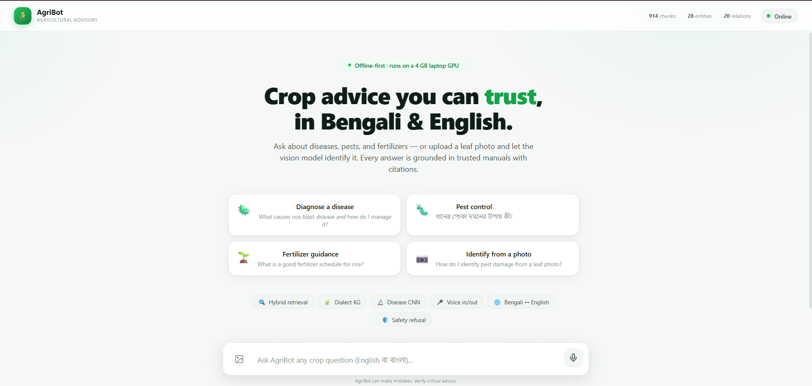

</div>

---

**AgriBot** is a fully **offline** agentic Retrieval-Augmented Generation (RAG) assistant that answers smallholder rice-farming questions in **Bengali and English** — from **text, voice, or a photo of a diseased leaf** — and **refuses unsafe chemical-dosage questions instead of guessing**. It runs end to end on commodity hardware (16 GB RAM + a 4 GB GPU) with **no internet connection**, so it works where connectivity and expert agronomists are scarce.

---

## 🎥 Demo Video

> 📹 **Demo video coming soon.**
>
> <!-- Add the demo here, e.g.: [](https://youtu.be/VIDEO_ID) -->
> <!-- Previous demo link (verify before using): https://youtu.be/pouhnGJOhFM -->

---

## ✨ Why AgriBot

| | |
|---|---|
| 🔌 **Fully offline** | LLM, translation, vision, speech, and retrieval all run on-device — nothing leaves the laptop. |
| 🗣️ **Bilingual** | Ask in Bengali or English (including colloquial dialect); answers come back in the same language. |
| 🖼️ **Multimodal** | Text, **voice** (speech-to-text), and **image** (rice-leaf disease classification) inputs. |
| 🛡️ **Safety-first** | A two-factor refusal policy declines chemical/fertiliser dosage questions — even when the corpus contains a number — and out-of-scope questions get an honest "I don't know." |
| 🧠 **Agentic RAG** | A bounded LangGraph loop grades evidence, rewrites weak queries, and **verifies** every answer against its sources before replying. |
| ⚡ **Edge-efficient** | A hardware-isolated design keeps only the LLM on the GPU; median answer latency is **3.4 s** on an RTX 3050 (4 GB). |

---

## 📸 Screenshots

### 🌐 Bilingual question answering (English ↔ বাংলা)
Grounded answers with source citations, in the user's language.

<table>
<tr>
<td width="50%">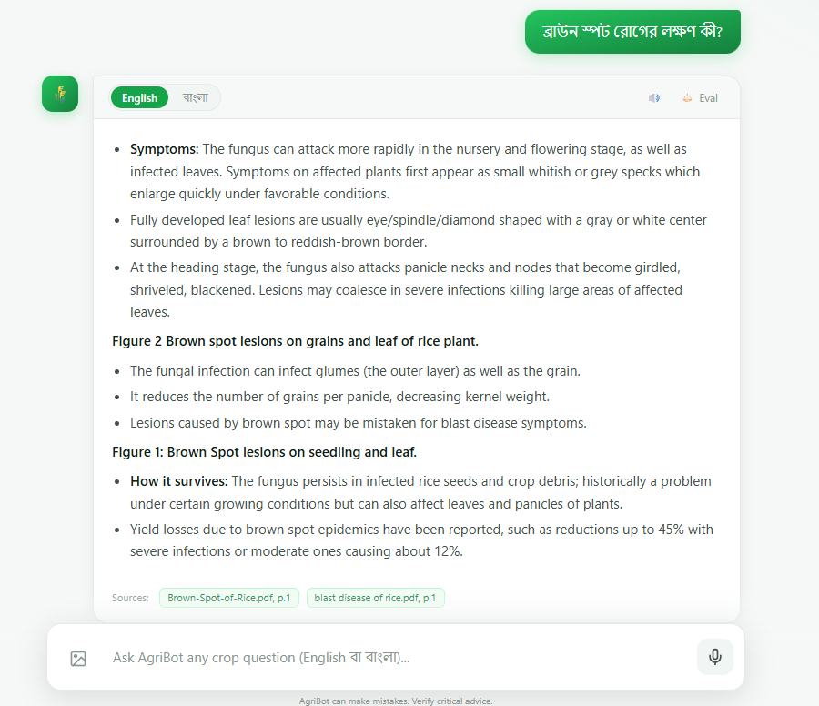<br/><sub><b>English</b></sub></td>
<td width="50%">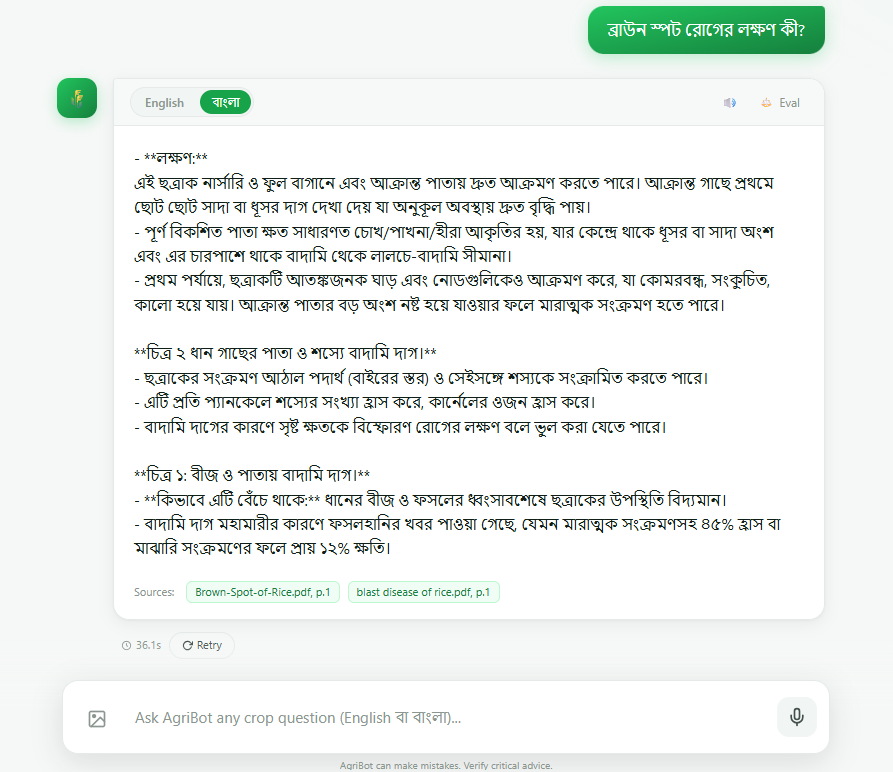<br/><sub><b>বাংলা</b></sub></td>
</tr>
</table>

### 🍃 Image-based disease diagnosis
Upload a rice-leaf photo → an on-device CNN classifies the disease and the agent explains symptoms, cause, and management.

<table>
<tr>
<td width="50%">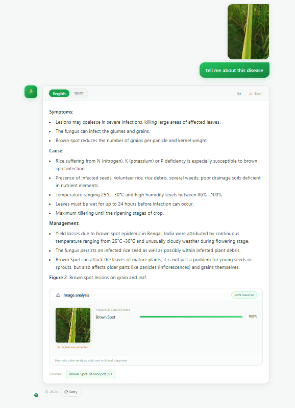<br/><sub><b>English</b></sub></td>
<td width="50%">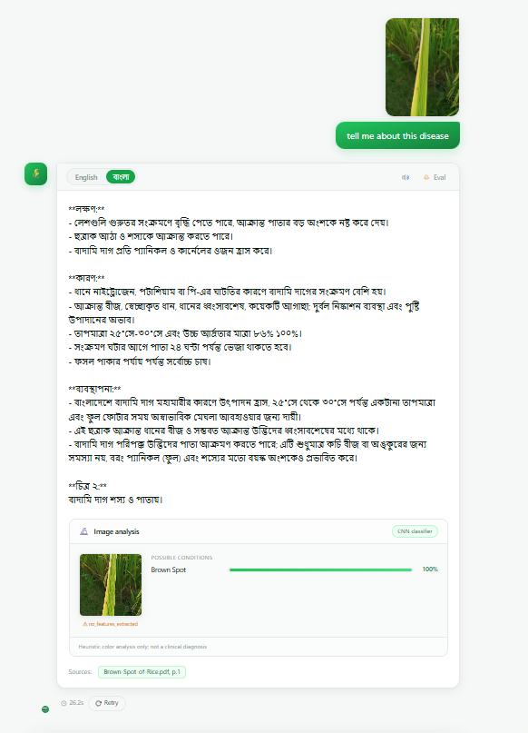<br/><sub><b>বাংলা</b></sub></td>
</tr>
</table>

### 🛡️ Safety — declines out-of-scope & unsafe questions
Out-of-corpus questions are refused honestly instead of being hallucinated.

<table>
<tr>
<td width="50%">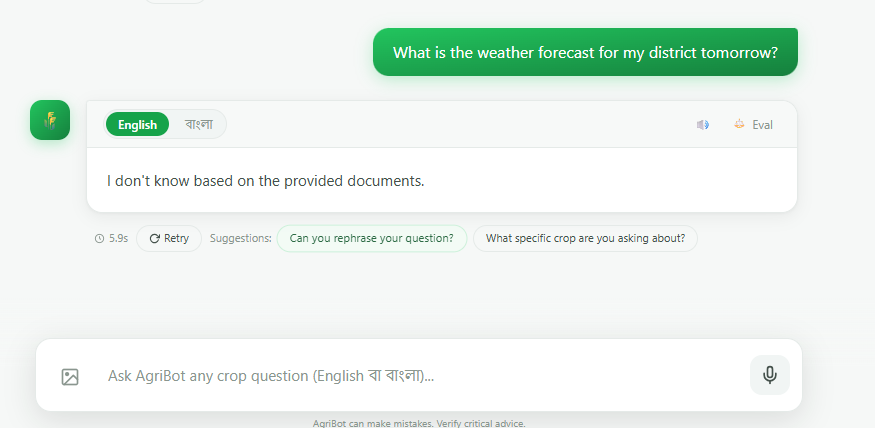<br/><sub><b>English</b></sub></td>
<td width="50%">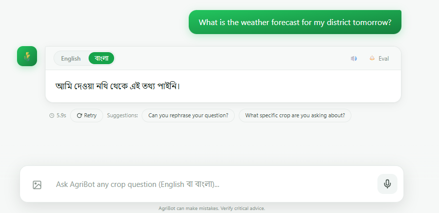<br/><sub><b>বাংলা</b></sub></td>
</tr>
</table>

### 🚫 Out-of-distribution image rejection
Non-leaf images (e.g., a bottle) are rejected — no fake diagnosis.

<div align="center">
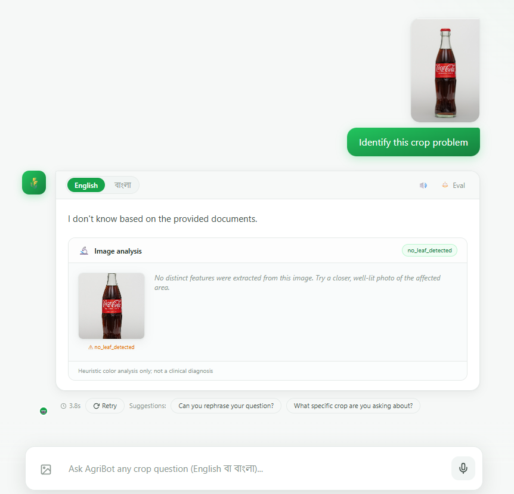
</div>

---

## 🏗️ System Architecture

Everything inside the dashed boundary runs **on the edge device, offline**. A FastAPI gateway routes text/voice/image requests to a LangGraph agent; only the language model occupies the GPU, while translation, vision, speech, and retrieval share the CPU.

<div align="center">
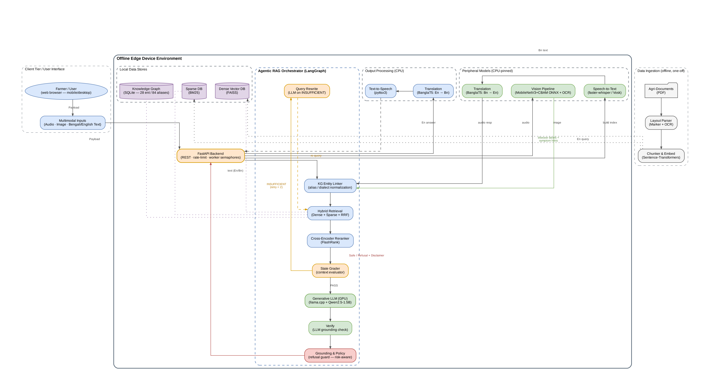
</div>

**Five layers:** (1) web client → (2) FastAPI gateway (rate-limiting, API-key, telemetry, worker semaphores) → (3) per-request preprocessors (STT, OCR + vision, translation) → (4) LangGraph agentic orchestrator → (5) local data stores (FAISS, BM25, SQLite knowledge graph).

---

## 🔁 How It Works — Agentic Workflow

Each query runs as a bounded state machine. Evidence is graded; weak retrievals trigger a bounded query rewrite; the generated answer is **verified against its sources**; and a risk-aware policy makes the final safety decision.

<div align="center">
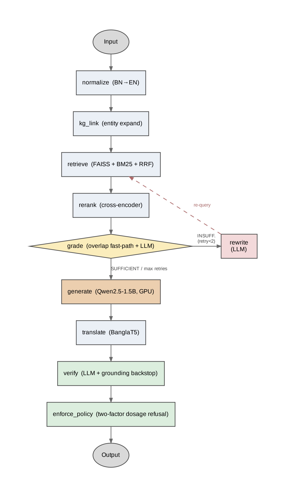
</div>

```
normalize (BN→EN) → kg_link → retrieve (FAISS+BM25+RRF) → rerank (cross-encoder)
   → grade ─┬─ SUFFICIENT ─→ generate → translate → verify → enforce_policy → answer
            └─ INSUFFICIENT → rewrite ↺ (bounded to 2 retries)
```

A hand-seeded **dialect knowledge graph** bridges colloquial Bengali terms to canonical English entities (e.g., *পাতা পোড়া* → *Rice Blast*) so non-standard queries still retrieve the right manual.

---

## 📊 Results

Evaluated on a 200-query bilingual benchmark and a held-out rice-disease image test set (single representative run; GPU generation has ±3 pp run-to-run variance).

| Dimension | Metric | Result |
|---|---|---|
| **Retrieval** | Recall@1 / @3 / @5 | 0.90 / **0.94** / 0.95 |
| | MRR (N = 153) | 0.92 |
| **Groundedness** | Verified-answer rate | **83.7 %** |
| **Safety** | Refusal recall (47 must-refuse queries) | **100 %** (zero unsafe answers) |
| | Answer precision | 100 % |
| **Vision** | Disease classifier accuracy (N = 575) | **96.2 %** |
| **Latency (GPU)** | median / p95 wall-clock | **3.4 s** / 12.5 s |
| **Stress** | 20 requests @ concurrency 5 | 0 crashes, 0 OOM |

A four-configuration ablation shows the full pipeline improves Recall@3 by **8.5 pp** over a naive dense-retrieval baseline, and **only the policy-equipped configurations refuse unsafe dosage questions** — the naive baseline leaks them. GPU offload cuts median latency **7.4×**.

<table>
<tr>
<td width="58%">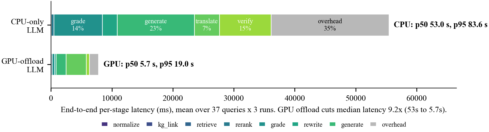<br/><sub>End-to-end latency — CPU vs GPU offload (7.4× median speedup)</sub></td>
<td width="42%">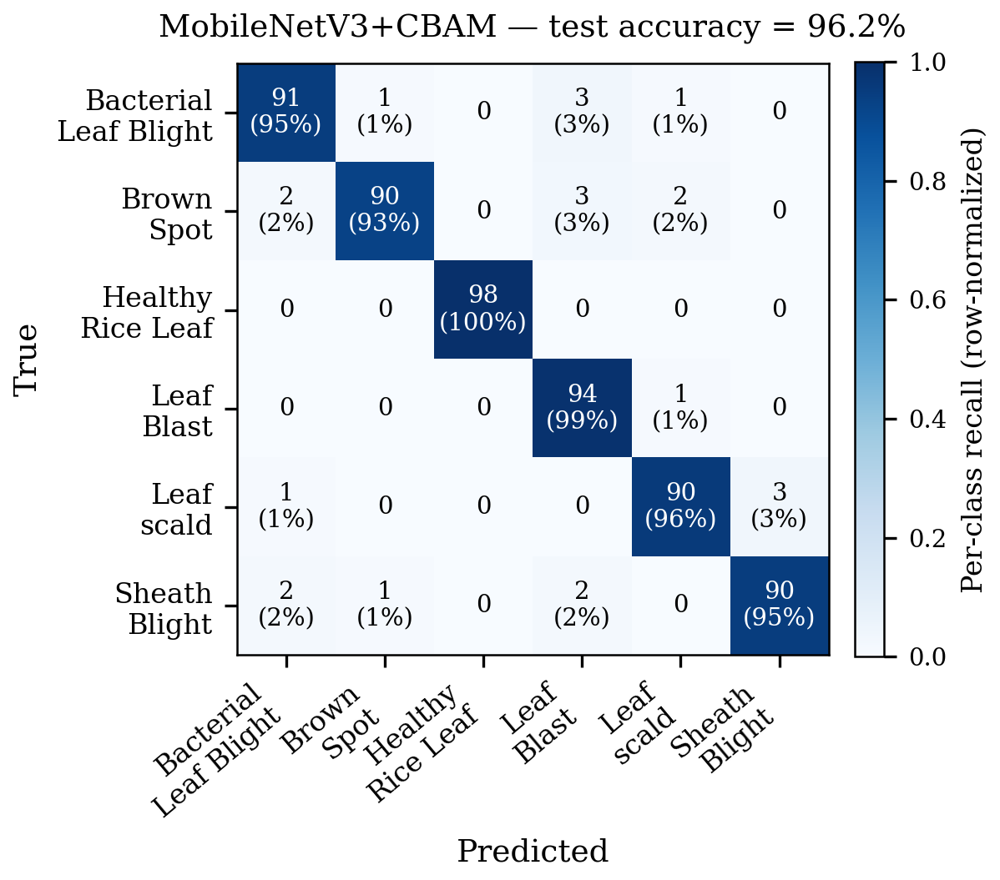<br/><sub>Rice-disease classifier confusion matrix</sub></td>
</tr>
</table>

---

## 🧰 Tech Stack

| Layer | Technology |
|---|---|
| **Generation LLM** | Qwen2.5-1.5B-Instruct (Q8_0 GGUF) via `llama-cpp-python` — GPU |
| **Retrieval** | FAISS (dense) + BM25 (sparse) + Reciprocal Rank Fusion + FlashRank cross-encoder |
| **Embeddings** | `all-MiniLM-L6-v2` |
| **Translation** | BanglaT5 EN↔BN (BUET NMT checkpoints) |
| **Vision** | MobileNetV3-Small + CBAM, exported to ONNX (`onnxruntime`) |
| **Speech** | faster-whisper → BanglaSpeech2Text → Vosk (fallback) · pyttsx3 TTS |
| **Knowledge graph** | SQLite dialect-bridging KG (28 entities, 84 aliases) |
| **Agent** | LangGraph bounded grade → rewrite → verify loop |
| **Backend / Frontend** | FastAPI · React 19 + Vite 7 + Tailwind 4 + Framer Motion |

---

## 🚀 Getting Started

> **Note:** Large model weights and prebuilt indexes are **not** committed (see `.gitignore`). You download the LLM once and build the indexes from your PDFs.

### Prerequisites
- Python **3.12**, Node **18+**
- (Optional, for GPU) an NVIDIA GPU with CUDA — CPU-only mode also works

### 1. Clone
```bash
git clone https://github.com/MdAsif-Hossain/Agri_bot_capstone_project.git
cd Agri_bot_capstone_project
```

### 2. Backend (Python)
```bash
python -m venv venv
# Windows: venv\Scripts\activate   |   Linux/Mac: source venv/bin/activate
pip install -r requirements.txt
cp .env.example .env               # adjust paths/flags if needed
```

Download the generation model into `models/`:
```
models/qwen2.5-1.5b-instruct-q8_0.gguf
```
(Translation, reranker, and speech models download automatically from Hugging Face on first run.)

Build the retrieval indexes from your corpus (place PDFs in `data/pdfs/`):
```bash
python ingest.py
```

Run the API:
```bash
python api.py            # CPU
python run_gpu.py        # GPU offload (needs the CUDA build of llama-cpp-python)
```
The backend serves on **http://localhost:8000** (`GET /v1/health` to check).

### 3. Frontend (React)
```bash
cd frontend
npm install
npm run dev
```
Open **http://localhost:5173** — the dev server proxies API calls to the backend automatically.

---

## 🗂️ Project Structure

```
Agri_bot_capstone_project/
├── agribot/             # Core package
│   ├── agent/           #   LangGraph nodes + graph (grade→rewrite→verify→policy)
│   ├── retrieval/       #   Hybrid FAISS + BM25 + RRF + reranker
│   ├── knowledge_graph/ #   SQLite dialect-bridging KG
│   ├── vision/          #   MobileNetV3+CBAM classifier + image OOD gate
│   ├── translation/     #   BanglaT5 EN↔BN
│   ├── voice/           #   STT cascade + TTS
│   └── llm/             #   llama.cpp engine (grade / generate / verify)
├── frontend/            # React 19 + Vite + Tailwind UI
├── evaluation/          # Reproducible evaluation harness + 200-query benchmark
├── docs/                # Architecture, deployment, model docs + figures
├── scripts/             # Figure generation, utilities
├── tests/               # pytest suite
├── models/              # Local model weights (gitignored)
├── data/                # PDFs + FAISS/BM25 indexes + KG (gitignored)
├── api.py               # FastAPI app
├── run_gpu.py           # GPU launcher
├── ingest.py            # Build retrieval indexes from PDFs
└── config.py            # Settings (env-driven, AGRIBOT_* vars)
```

---

## 🧪 Evaluation

The `evaluation/` harness reproduces every reported metric; each script writes a versioned JSON result.

```bash
python -m evaluation.eval_retrieval     # Recall@k, MRR
python -m evaluation.eval_grounding     # verified rate, citations
python -m evaluation.eval_refusal       # refusal confusion matrix
python -m evaluation.eval_ablation      # 4-configuration ablation
python -m evaluation.stress_test        # concurrency / stability
```

The benchmark (`evaluation/dataset.json`, 200 bilingual queries) is released with the code.

---

## ⚠️ Limitations & Responsible Use

AgriBot is a **research prototype**, not a certified agronomic advisor.
- It **deliberately refuses** specific chemical/fertiliser dosage requests — correct dosing depends on soil, climate, variety, and growth stage and must come from a qualified extension officer.
- Benchmark scores come from a corpus-grounded, internally labelled set and should be read as **upper bounds**; no farmer field study has been run yet.
- The vision classifier is closed-set (6 rice diseases) with a coarse non-leaf gate; a *different* plant's leaf could still be misclassified.

---

## 👥 Authors

Md. Asif Hossain · Nabil Subhan · Mantasha Rahman Mahi · Jannatul Ferdous Nabila
Supervised by **Dr. Farhana Huq** — Department of Computer Science and Engineering, **East West University**, Dhaka, Bangladesh.

*Undergraduate capstone project.*

---

<div align="center">
<sub>Built to put trustworthy, in-language agricultural knowledge in farmers' hands — even without the internet. 🌱</sub>
</div>
